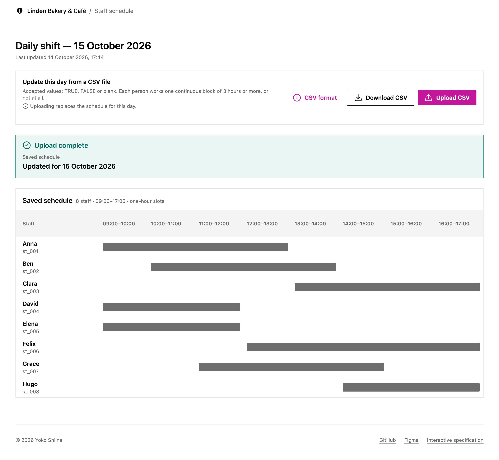
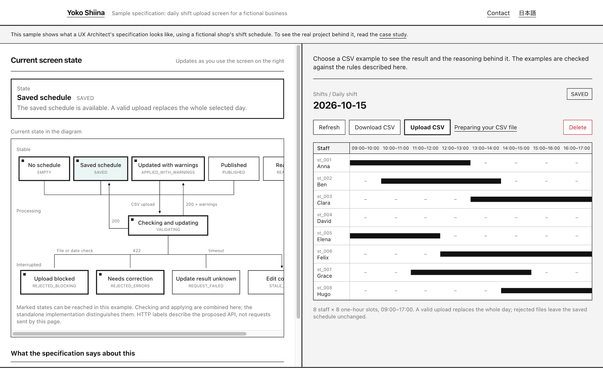

# Linden Bakery & Café — Staff Schedule Dashboard

|                                  [Live implementation](https://ux-sample-dashboard.solastudio.studio/)                                  |                                         [Interactive UX specification](https://ux.solastudio.studio/spec-sample)                                         |
| :-------------------------------------------------------------------------------------------------------------------------------------: | :------------------------------------------------------------------------------------------------------------------------------------------------------: |
| [](./public/images/mock-image.png) | [](./public/images/sample-spec.png) |

A focused implementation sample from Yoko’s UX Architect portfolio: the daily CSV-upload workflow for a fictional bakery’s staff schedule. It implements a selected part of the portfolio’s screen specification, using the linked Figma daily-shift designs as the interface reference. The sample demonstrates how validation rules, outcome states, recovery guidance, and accessibility decisions translate into working code.

- **[Live demo](https://ux-sample-dashboard.solastudio.studio/)** — try the daily CSV-upload workflow. Files are processed in your browser; saved changes reset when the page is refreshed.
- **[Portfolio · interactive specification sample](https://ux.solastudio.studio/spec-sample)** — explore the relationship between interface behavior and its specification.
- **[Figma · dashboard design](https://www.figma.com/design/mLdmFMaurH8tFL0VwA6TuK/Linden-Bakery---Caf%C3%A9---Staff-Schedule-Dashboard?node-id=0-1)** — inspect the design file.
- **[Source repository](https://github.com/yokoworks/ux-sample-dashboard)** — explore and run this implementation.

## Implementation scope

This repository covers the daily CSV-upload interaction and its associated dashboard states. The broader specification’s API contracts and database design are outside this implementation’s scope.

| Area                         | Implemented scope                                                                                                                                                                                                                                                                         |
| ---------------------------- | ----------------------------------------------------------------------------------------------------------------------------------------------------------------------------------------------------------------------------------------------------------------------------------------- |
| Daily dashboard              | One fixed example day: 15 October 2026, eight staff, and eight one-hour slots from 09:00 to 17:00.                                                                                                                                                                                        |
| CSV input and download       | Real local-file selection, UTF-8 reading, parsing, validation, and CSV generation from the currently loaded saved snapshot. Schedule files are processed in the browser; they are not sent to an upload endpoint.                                                                         |
| Interface behavior           | Checking, applying, blocking errors, collected corrections, success, coverage warnings, conflict, unknown result, load failure, and explicit recovery. The state examples are mapped to Figma below.                                                                                      |
| Save and recovery simulation | An in-memory store and asynchronous mock gateway reproduce whole-day replacement, revision conflicts, committed/uncommitted lost responses, and reload failures. Refreshing the browser resets the data.                                                                                  |
| Backend API and database     | No scheduling HTTP endpoints, API request/response contract implementation, database schema, migrations, persistent storage, or database transactions. The mock gateway’s TypeScript interface is a local simulation boundary, not an implementation of the specification’s API contract. |
| Wider scheduling service     | No month navigation, publication workflow, authentication, role-based permissions, or staff-management screens.                                                                                                                                                                           |

The local schedule types and revision counter support the demonstration; they do not reproduce a service-wide data model or prove backend concurrency guarantees. “Saved” in the UI means committed to the current in-memory demo store. The `409` design state is simulated without an actual HTTP response.

## What this sample demonstrates

The workflow makes three distinctions explicit: input that cannot be saved, a confirmed save with staffing warnings, and an update whose result is still unknown. Each state explains what happened to the saved schedule and what the user can do next.

The implementation supports:

- Check the file, validate its complete contents, and apply one whole day to an in-memory mock store.
- Show blocking file errors, collected corrections, successful saves, and post-save coverage warnings.
- Keep the loaded grid and timestamp unchanged throughout checking, applying, and rejected attempts.
- Download the currently loaded saved values, including a successful replacement.
- Provide Radix CSV help, semantic table navigation, focused error summaries, and polite progress and save announcements.

The recovery interaction is implemented against the mock gateway: simulated revision conflicts and unknown upload results lead to explicit reload, retry after a load failure, and a persistent notice after recovery. Upload and Download remain unavailable until a reliable saved snapshot has been loaded again; CSV format help stays available.

The mock scenarios are scoped to one mounted screen; separate tabs do not share a schedule. Refreshing the browser resets the demonstration and rearms the selected scenario.

## Run locally

Use Node.js 24 LTS and npm.

```sh
npm ci
npm run dev
```

Open `http://localhost:3001`.

```sh
npm run lint    # ESLint
npm run typecheck # Strict TypeScript
npm test        # Domain, workflow, and notification-timing tests
npm run build   # Production build
npm start      # Serve the production build
```

Inter and JetBrains Mono are loaded through `next/font/google` and self-hosted in the generated build. The first build requires access to Google Fonts.

## Try the workflow

Start the app, then use **Upload CSV** to choose one of the files in `public/examples/`. The files are also served at `/examples/<filename>` during local development. Use the examples with the selected day of October 15, 2026. The wrong-date.csv file intentionally contains October 16 to demonstrate date-mismatch rejection.

| File                 | Expected result                                                                                             |
| -------------------- | ----------------------------------------------------------------------------------------------------------- |
| `success.csv`        | Whole-day replacement, no coverage warnings                                                                 |
| `warnings.csv`       | Saved; one person at 09:00–10:00 and nobody at 16:00–17:00                                                  |
| `all-off-duty.csv`   | Saved; one grouped zero-coverage warning for 09:00–17:00                                                    |
| `corrections.csv`    | Four corrections: Anna's short shift, Clara's split shift, an invalid value on row 4, and Ben's missing row |
| `wrong-date.csv`     | Blocking date mismatch; saved schedule unchanged                                                            |
| `missing-column.csv` | Blocking missing time column; saved schedule unchanged                                                      |
| `truncated-row.csv`  | Blocking incomplete record; saved schedule unchanged                                                        |

After a successful upload, download the CSV and inspect the changed values. Then upload `corrections.csv`: the saved grid, timestamp, and downloadable values must still describe that last successful save. Cancelling the file picker does nothing. You can select the same file again.

Open **CSV format** with the keyboard and close it with Escape; focus returns to the trigger. On a narrow viewport, focus the schedule region and scroll horizontally through all eight columns. Additional manual accessibility checks are listed below.

## Try recovery scenarios

Open a scenario URL below, then upload `public/examples/success.csv`. Use the **Reload** button inside the result panel, not the browser refresh button. Each upload scenario affects the first file that passes local validation; later uploads run normally. Opening the URL again resets the scenario.

| Scenario URL                                                                    | Expected result and recovery                                                                                                                                                         |
| ------------------------------------------------------------------------------- | ------------------------------------------------------------------------------------------------------------------------------------------------------------------------------------ |
| [Conflict](http://localhost:3001/?scenario=conflict)                            | A simulated second editor saves David's 12:00–15:00 shift. Your upload is rejected against its stale loaded revision. Reload shows the other editor's shift and the recovery notice. |
| [Unknown, committed](http://localhost:3001/?scenario=unknown-committed)         | The upload saves but its response is lost. The UI reports an unknown result and retains the old grid. Reload reveals David's uploaded 09:00–12:00 shift.                             |
| [Unknown, not committed](http://localhost:3001/?scenario=unknown-not-committed) | The upload does not save and its response is lost. The UI shows the same unknown-result state. Reload reveals the unchanged original schedule.                                       |
| [Reload failure](http://localhost:3001/?scenario=reload-failure)                | A conflict occurs first. The first Reload fails and replaces the table with the load-error view. Try again loads the latest saved schedule and restores both CSV actions.            |
| [Initial load error](http://localhost:3001/?scenario=load-error)                | Starts from a failed-load fixture: no grid, timestamp, or usable CSV actions. Try again loads the initial schedule. No upload is needed.                                             |

In conflict and unknown states, the previous grid remains readable with an out-of-date banner. Neither Upload nor Download is usable, and help remains available. Reloading never resubmits the file. A successful recovery shows **Latest schedule loaded** and persistent guidance to download a fresh CSV and transfer older edits. This notice stays until the next upload attempt; it is not a timed toast.

The CSV contains no revision token. The store compares the submitted **screen revision** to its current revision. After reloading, an explicitly resubmitted old CSV can still overwrite intervening edits. This demonstration does not claim to solve file provenance or merge conflicts.

See [manual-checks.md](docs/manual-checks.md) for exact keyboard, download, and narrow-viewport checks.

## Stack

Next.js App Router, React, TypeScript, Tailwind CSS, Radix Primitives, and Lucide icons. The application is a standalone project and does not require a real backend for its demonstration scenarios.

## Design-to-code mapping

The Figma file’s daily-shift screen examples correspond to the following code states. The mapping covers the daily-upload UI states and their interaction logic.

| Figma screen               | Code representation                                                                        |
| -------------------------- | ------------------------------------------------------------------------------------------ |
| 01 Ready                   | `ready` with the initial saved snapshot.                                                   |
| 02 Corrections needed      | `corrections`; collected issues leave the saved snapshot unchanged.                        |
| 03 Applied with warnings   | `applied` with coverage warnings after a confirmed mock commit.                            |
| 04 Blocking error          | `blocking`; the file is rejected before replacement.                                       |
| 05 Applied                 | `applied` with no coverage warnings.                                                       |
| 06 Checking file           | `checking` while reading and validating the local file.                                    |
| 07 Applying                | `applying` while awaiting the mock gateway.                                                |
| 08 Conflict (409)          | `conflict`; the loaded revision is stale, so data actions require reload.                  |
| 09 Result unknown          | `unknown`; the old view is retained until an explicit reload establishes the saved result. |
| 10 Load error              | `load-error`; no usable saved snapshot is shown, and Try again loads it.                   |
| 11 Reloaded after conflict | `reloaded`; the latest mock snapshot and persistent recovery guidance are shown.           |

`reloading` and retry-in-progress feedback connect these examples during interaction. The CSV help dialog, file picker, and download behavior are implemented alongside the screen examples.

| Figma component | React implementation                           | Responsibility                                                                     |
| --------------- | ---------------------------------------------- | ---------------------------------------------------------------------------------- |
| Button          | `src/components/ui/button.tsx`                 | Native button semantics, hierarchy, disabled/busy contract, focus styling          |
| UploadBar       | `src/components/schedule/upload-bar.tsx`       | CSV guidance, actions, processing state                                            |
| ShiftTable      | `src/components/schedule/shift-table.tsx`      | Saved snapshot, out-of-date/load-error variants, named table, horizontal scrolling |
| StaffCell       | `src/components/schedule/staff-cell.tsx`       | Row heading with name and ID                                                       |
| TimeHeaderCell  | `src/components/schedule/time-header-cell.tsx` | One-hour column heading and coverage warning                                       |
| ShiftCell       | `src/components/schedule/shift-cell.tsx`       | Joined visual bars with per-cell text alternatives                                 |
| ResultPanel     | `src/components/schedule/result-panel.tsx`     | Typed processing, validation, applied, conflict, unknown, and reloaded variants    |
| ResultItem      | Local `ResultItem` in `result-panel.tsx`       | Shared location, message, and entered-value presentation                           |

`DailyShiftScreen` composes the screen. `CsvFormatDialog` adds the interaction needed by the CSV format action. Layout-only Figma frames become HTML elements rather than one React component per layer. Review annotation markers remain design documentation, not application content.

Semantic color and radius tokens are defined in `src/app/globals.css`. The desktop target is 1440 px with a 1120 px content area. Smaller screens wrap the action bar and scroll the table while retaining all eight columns.

## Project structure

```text
src/app/                   App Router entry points and design tokens
src/components/ui/         Shared interface primitives
src/components/schedule/   Schedule-specific presentation and interactions
src/domain/                Schedule types and presentation-independent helpers
src/data/                  Illustrative saved schedule fixture
src/lib/csv/               File reading, parsing, importing, and export
src/lib/mock/              Versioned atomic store and asynchronous scenario gateway
src/lib/upload/            Observable upload workflow
public/examples/           Reproducible scenario CSVs
tests/                     Parser, rules, store, workflow, and fixture tests
docs/                      Architecture and accessibility decisions
```

## CSV and shop rules

- One row per active staff member, including people who are off duty.
- Required columns: `date`, `staff_id`, and the eight hourly intervals from `09:00-10:00` through `16:00-17:00`.
- Import accepts uppercase `TRUE`, `FALSE`, or an existing empty cell after trimming surrounding whitespace. Empty means not scheduled. Numeric and single-letter aliases are invalid.
- Missing rows, headers, or structurally truncated records are distinct from empty cells.
- Each person is off duty or works exactly one continuous block of at least three hours. Split shifts are invalid even when both blocks last three hours.
- A valid upload replaces the whole selected day. Coverage of zero or one person produces a warning **after** successful application.
- Download serializes the loaded snapshot, not a fresh server query, and never includes coverage totals.

The fixture uses an illustrative date and a fixed UTC clock for deterministic rendering; it does not apply a current-date scheduling restriction. Each mock commit advances that illustrative clock by one minute. It is not a real server timestamp.

### Current import choices

- UTF-8 `.csv` files up to 1 MiB; the filename extension is checked independently of the browser MIME hint.
- Comma delimiters, quoted fields, doubled quotes, UTF-8 BOM, and CRLF/LF/CR line endings are supported. Diagnostic row numbers refer to physical starting lines.
- All required headers must appear once. Reordered columns are accepted; extra columns are rejected. Every record must contain exactly as many fields as the header.
- Existing empty fields mean `FALSE`; removing a row or a field is an error. Lowercase values and aliases such as `1` or `T` are rejected.
- File, structure, and date checks precede collected staff/value/shift corrections. Unparseable values suppress derived shift errors for that row. Split-shift errors take priority over short-period errors.

The file-size, encoding, and extra-column policies are explicit demo implementation choices. They can be adjusted without changing the shop's scheduling rules.

## Accessibility

The screen uses `header` and `main` landmarks, a single `h1`, a table named by its visible heading, column headings, and staff row headings. Every hour cell exposes “Scheduled” or “Not scheduled”; the bar itself is decorative. Radix Dialog provides modal focus management, Escape handling, and an accessible title and description.

See [accessibility.md](docs/accessibility.md) for implemented behavior, reported manual checks, and notification behavior. Component choices alone are not evidence of accessibility conformance.

## Verification status

On 18 October 2026, all 32 automated tests passed with Node.js 24.19.0.Tests exercise real CSV fixtures, structural versus blank-cell handling, shift-rule precedence, atomic rejection, pending snapshot preservation, duplicate submission prevention, export after replacement, stale revisions, lost responses, failed reloads, explicit recovery without automatic resubmission, and notification scheduling and cancellation.

Run `npm run check` for lint, generated route types, strict TypeScript checks, the test suite, and a production build. The manual verification record below is separate from automated test results.

On 18 October 2026, npm run check passed: ESLint, route-type generation, strict TypeScript checks, all 32 automated tests, and the production build with Next.js 16.3.8.

Manual checks cover the reported VoiceOver scenarios, 200% and 400% zoom, forced colors, and reduced motion. Completion notifications were confirmed in both Chrome and Safari without manually navigating to the result panel. See [accessibility.md](docs/accessibility.md) for environments and verification scope.

See [architecture.md](docs/architecture.md) for the implementation decisions and mock-service boundaries.

## References

- [Next.js documentation](https://nextjs.org/docs)
- [Radix Dialog](https://www.radix-ui.com/primitives/docs/components/dialog)
- [Tailwind CSS](https://tailwindcss.com/docs)
- [Lucide](https://lucide.dev)

Interface and status icons use Lucide React components.

## License and use

The original code and documentation in this repository are shared for portfolio review. You may read the source and run an unmodified copy locally for evaluation.

No open-source license is granted. Reuse in other projects, modification, or redistribution requires prior permission, except where permitted by applicable law or GitHub’s Terms of Service. Third-party dependencies remain subject to their respective licenses.
